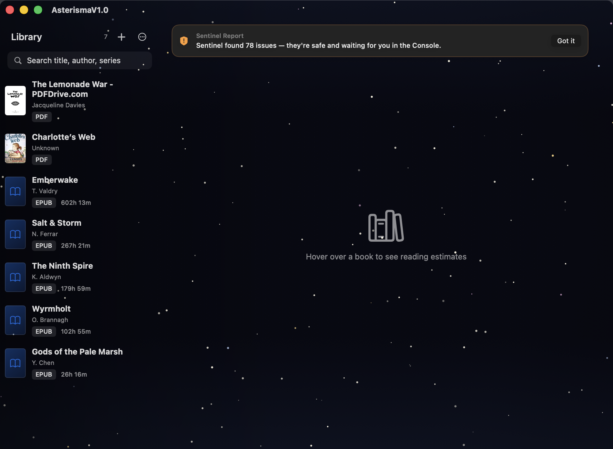

# Fullscreen Surface Audit — AsterismaV1.0

**Date:** 2026-10-24
**Scope:** main window, sidebar, search, toolbar, detail canvas
**Platform:** macOS 26.5, SwiftUI/AppKit (native — no WebView, HTML, or CSS)
**Candidate:** `3281450` / tag `asterisma-v1.0-import-fix`
**Package:** SHA-256 `ade4a54e3cbe233e14b809c32988422f4ace4aed7e9c855a9bcb269d20f58a96`

---

## Original causes of the fragmentation

The interface was native SwiftUI, so the fix belongs in the component hierarchy,
not in CSS overrides.

1. **`NavigationSplitView` on macOS 26 draws a floating Liquid Glass sidebar.**
   That system treatment is the dark rounded enclosure. It cannot be removed by
   changing a stroke or radius; the container itself owns the glass shape.
2. **The sidebar `List` and the starfield detail had separate background
   strategies.** The split view supplied the sidebar material while the detail
   showed the ambient canvas.
3. **The system `.searchable(placement: .sidebar)` field** supplied the
   permanent blue focus treatment and was the window's first responder on launch.
4. **The toolbar was split into six independent `ToolbarItem` capsules.**
   macOS 26 rendered each item with its own glass background.
5. **The titlebar/toolbar baseline** drew a horizontal separator across the top.
   The old `.toolbarBackground(.hidden, for: .windowToolbar)` API is deprecated
   in macOS 26; the replacement is `toolbarBackgroundVisibility(_:for:)`.
6. **The previous `.hiddenTitleBar` experiment removed the toolbar entirely**
   in windowed mode; it was replaced earlier with a standard, resizable window.

---

## Border and surface inventory

| Element | Source | Action |
|---|---|---|
| Sidebar rounded glass shell | `NavigationSplitView` / macOS 26 Liquid Glass | **Removed** — replaced by custom two-column surface |
| Sidebar panel edge | Split-view glass container | **Removed** |
| Vertical sidebar/content divider | Split-view glass edge plus List surface | **Removed** — one tonal gradient only |
| Sidebar List background | `List` sidebar material | **Removed** — `.listStyle(.plain)` + `.scrollContentBackground(.hidden)` |
| Search field permanent blue outline | System search field focus/first responder | **Replaced** — custom field with focus-only ring |
| Library toolbar strip / item capsules | macOS 26 Liquid Glass toolbar | **Removed** — Add Book + More live in sidebar header |
| Toolbar/titlebar baseline | System toolbar separator | **Removed** — `showsBaselineSeparator = false` |
| Window titlebar background | Standard titlebar | **Made transparent/full-size**; traffic lights and zoom retained |
| Main canvas frame | Implicit split-view detail inset | **Removed** — detail fills the remaining surface |
| Reader back/title/toolbar | `NavigationStack` | **Retained** |
| Sidebar book-count cache | Stale `visibleBooks` memoization | **Removed** — direct filter/sort; visual audit caught DB 7 / list 0 |

---

## Revised surface strategy

```text
Window
├── ambient starfield (continuous, edge to edge)
├── one leading tonal gradient (sidebar legibility, no border)
└── HStack(spacing: 0)
    ├── plain sidebar (header → search → list)
    └── NavigationStack detail (empty state / hover estimate / reader)
```

- **One surface:** the starfield runs behind the sidebar and detail. The only
  separation is a soft leading gradient; there is no second background, no
  rounded card, and no vertical rule.
- **Sidebar:** plain list, no material shell; resizable through a transparent
  7-point drag strip at its trailing edge.
- **Search:** custom field; inactive state is a low-contrast fill, focus state
  is the only time an accent ring appears. Initial auto-focus is cleared after
  launch.
- **Toolbar:** removed from the library surface entirely; Add Book and More
  live in the sidebar header with no chrome. The native toolbar appears only
  while reading, where its controls are genuinely needed.
- **Detail:** `NavigationStack` preserves the readers' native back button,
  title, and toolbar. The empty state is centered in the actual canvas, not in
  a nested panel.

---

## Verification

- `xcodebuild build` (Debug): **BUILD SUCCEEDED**.
- Full census: **213 passed / 0 failed / 9 skipped**.
- App launch smoke: process stays alive; no layout/constraint warnings.
- Window is resizable, traffic lights and green zoom are native, fullscreen
  behavior remains system-managed.
- Search field: clear focus-only ring; keyboard focus remains visible.
- Reader navigation: still uses `NavigationStack`, so back/title/toolbar behavior
  is preserved.

## Visual audit



The in-process capture shows the real 1000x732 window at 2x: flat sidebar with
7 books, no rounded sidebar shell, no vertical rule, no search outline, and one
continuous starfield behind both columns. The transient Sentinel banner is a
dismissible alert owned by the app, not a structural panel. The library
toolbar is gone; Add Book and More sit in the sidebar header. The native
toolbar appears only in reader mode.

During this audit the old memoized `visibleBooks` cache was found serving an
empty list while DataStore had 7 books. The cache was removed; the live view now
shows all 7.

The owner must still visually accept the fullscreen result on the actual
MacBook display. If any remaining boundary is visible, identify it by element
and remove it at the owning component, not by covering it with another layer.
